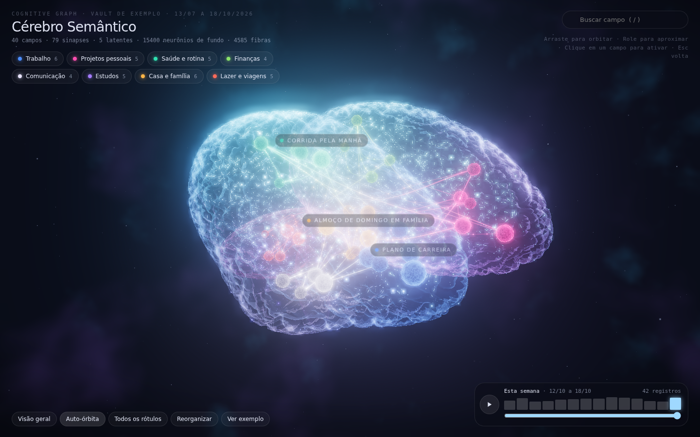

# Cérebro Semântico

Transforma um vault de notas Markdown (formato Obsidian) num cérebro 3D navegável. Cada nota de tema vira um neurônio no lobo da sua área. Cada link vira uma sinapse. Uma linha do tempo semanal mostra quais assuntos esquentaram e quais esfriaram.



Origem da captura: [fontes e hashes](docs/img/preview-origin.json). Verificação: `python3 tools/visual/preview.py --check --verify-ci`.

*English summary at the end.*

## Em 1 minuto

Abra `prototype/cerebro-semantico-3d.html` no navegador. A página é um arquivo único e já traz o grafo do vault fictício de `examples/`. Ela baixa Three.js e GSAP do CDN jsDelivr, então precisa de internet na primeira carga.

Controles: arraste para orbitar, role para aproximar, clique num neurônio para ativar, `Esc` volta, `/` busca. A linha do tempo fica no canto inferior direito.

## Com o seu vault

Requisito: Python 3.9 ou mais novo. O pipeline usa só a biblioteca padrão.

```bash
cp config/config.example.json config/config.json      # config.json fica fora do git
# edite categories, vault.path, vault.folders e timeline.start
python3 pipeline/build_graph.py --config config/config.json --out out/grafo.json --source "Minhas notas"
python3 pipeline/embed_viewer.py --template prototype/cerebro-semantico-3d.html \
    --json out/grafo.json --out out/meu-cerebro.html
```

`build_graph.py` sai com código 1 se um nome de pessoa (título de nota do tipo `pessoa`) aparecer no grafo. Corrija com `graph.rename` antes de publicar.

### O que o vault precisa ter

| Elemento | Formato | Uso no cérebro |
|---|---|---|
| Pasta | uma por área, mapeada em `vault.folders` | define a categoria e o lobo |
| Frontmatter | `tipo`, `dominio`, `tags`, `confianca` em linhas `chave: valor` | filtra notas, gera rótulo e conexões latentes |
| Wikilink | `[[Título]]` | sinapse direta |
| Fato datado | linha `- AAAA-MM-DD: texto` | atividade da semana |
| Evento | linha `- AAAA-MM-DD \| Domínio \| texto \| [[Nota]]` numa nota `Eventos ...` | atividade da nota citada e linha do tempo |

Notas de `tipo` pessoa, hub, período, eventos e pendências ficam fora do grafo. Veja o vault de exemplo em `examples/vault` e o formato do JSON em [docs/FORMATO_GRAFO.md](docs/FORMATO_GRAFO.md).

## Como o grafo é calculado

- **Peso**: grau do nó no grafo de links, normalizado entre 0,3 e 1.
- **Proximidade**: 0,45 de base, +0,2 se o link é recíproco, até +0,35 pela vizinhança em comum (Jaccard), +0,05 na mesma pasta.
- **Latentes**: pares sem link direto que dividem uma pessoa ou duas tags. No máximo 2 por nó. Ficam quase invisíveis e acendem quando um vizinho é ativado.
- **Calor**: registros datados por semana com meia-vida de 3 semanas. Define tamanho e brilho do neurônio, força das sinapses e o mapa de calor dos lobos.

## Pipeline opcional: mensagens para o vault

Para alimentar o vault com conversas exportadas (uma mensagem por linha em NDJSON):

1. `prep_messages.py` redige CPF, CNPJ, processo, telefone, e-mail, URL, cartão e credenciais, troca conversas sigilosas por alias estável e grava um extrato por área.
2. Um modelo de linguagem atualiza as notas da área a partir do extrato, seguindo `pipeline/briefing.template.md`.
3. `lint_vault.py` falha se uma nota tiver dado sigiloso ou nome de contato sigiloso.
4. `timeline.py` reconstrói as notas de linha do tempo e o CSV de eventos.
5. `build_graph.py` e `embed_viewer.py` geram a página.

Leia [docs/PRIVACIDADE.md](docs/PRIVACIDADE.md) antes de usar com dados reais.

## Desenvolvimento

```bash
python3 -m unittest discover -s tests        # 53 testes, só biblioteca padrão
python3 scripts/check_size.py                # limite de 20.000 bytes por arquivo de texto
python3 examples/gerar_vault_exemplo.py      # regenera o vault de exemplo
python3 tools/visual/smoke.py --html prototype/cerebro-semantico-3d.html   # opcional, precisa de playwright
```

Mapa do código: [docs/agent/REPO_MAP.md](docs/agent/REPO_MAP.md). Decisões: [docs/agent/DECISIONS.md](docs/agent/DECISIONS.md). Estado atual e próximos passos: [docs/HANDOFF.md](docs/HANDOFF.md).

## English summary

Cérebro Semântico turns an Obsidian-style Markdown vault into an interactive 3D brain. Topic notes become neurons placed in the lobe of their area, wikilinks become synapses, and a weekly timeline shows how "hot" each topic was. Open `prototype/cerebro-semantico-3d.html` to see the fictional example. To use your own vault, copy `config/config.example.json`, then run `pipeline/build_graph.py` and `pipeline/embed_viewer.py`. The pipeline is pure Python standard library (3.9+). An optional message pipeline redacts personal data (Brazilian formats) before any text reaches a language model. The UI and docs are in Brazilian Portuguese.

## Licença

MIT. Ver [LICENSE](LICENSE).
