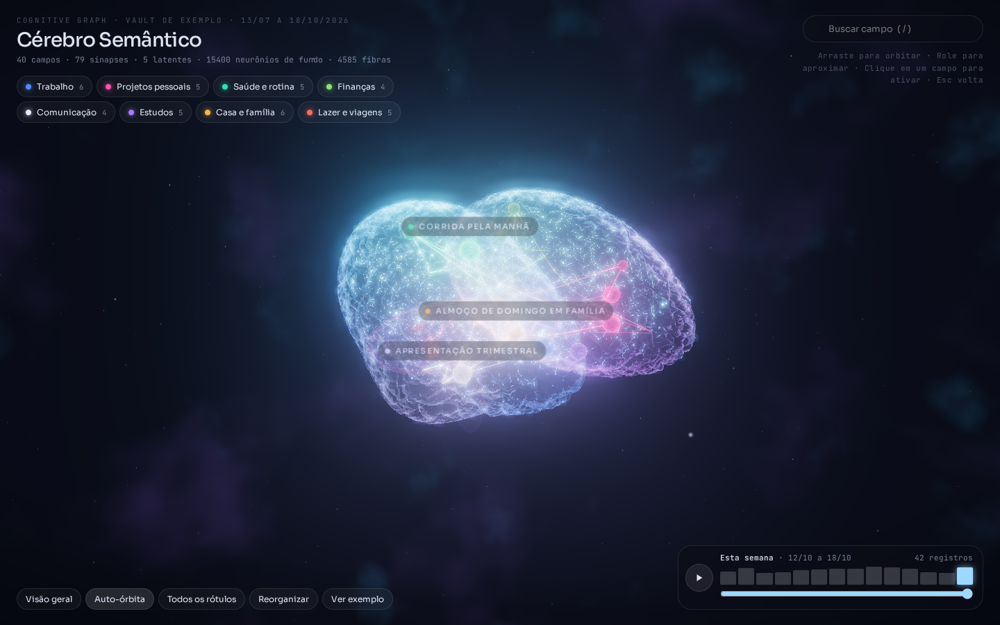
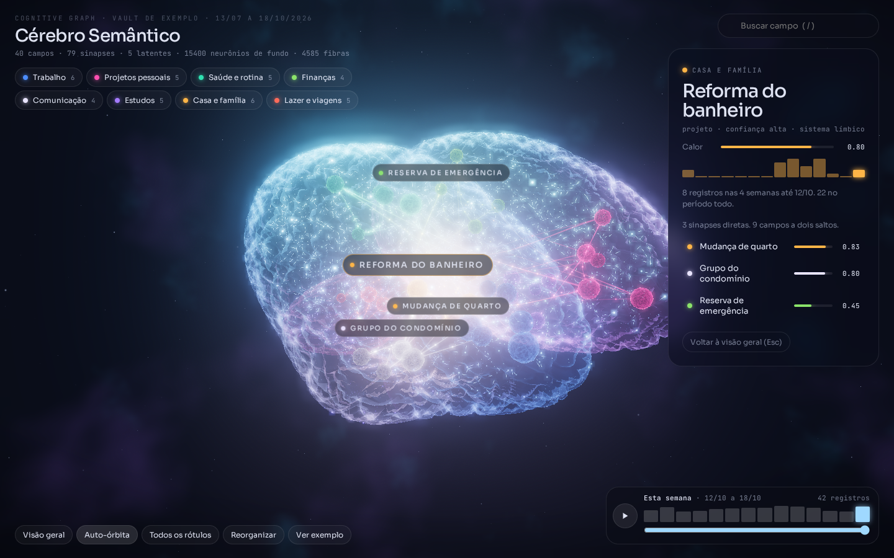
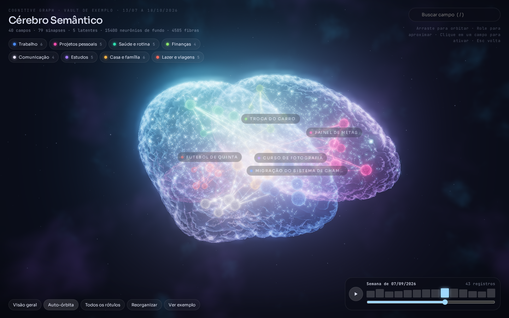
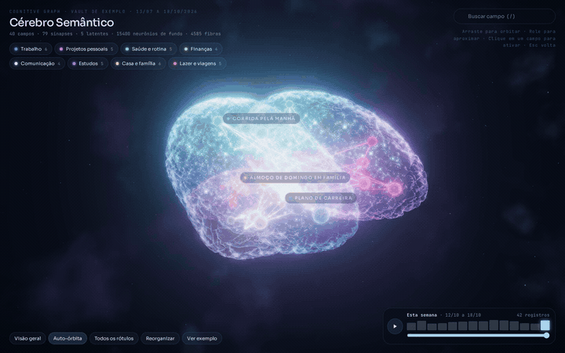
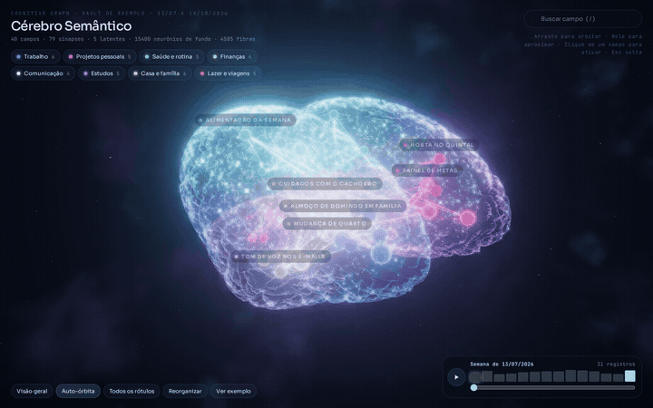

# Cérebro Semântico · Semantic Brain

**Português** | [English](README.en.md)

[](https://github.com/alexander-stack1/cerebro-semantico/actions/workflows/ci.yml)
[](LICENSE)
[](https://www.python.org/)

> Transforme mensagens do WhatsApp em um histórico organizado por temas e explore suas conexões em um cérebro 3D. Esta versão foi preparada especialmente para integrar mensagens coletadas pela API do WhatsApp a um vault de notas Markdown.



A coleta pela API e a adaptação das mensagens são feitas por uma integração externa. Este repositório oferece o processamento dos extratos, do vault e do grafo; também funciona com notas Markdown criadas por outras fontes. A interface e o exemplo permanecem em português; os guias de entrada estão disponíveis nos dois idiomas.

## Sumário

- [Histórico a partir do WhatsApp](#histórico-a-partir-do-whatsapp)
- [Início rápido](#início-rápido)
- [Galeria](#galeria)
- [Capacidades e limites](#capacidades-e-limites)
- [Documentação](#documentação)

## Histórico a partir do WhatsApp

```text
API do WhatsApp → coleta e adaptação externas → mensagens novas em NDJSON
→ extratos redigidos por tema → atualização das notas por modelo externo
→ validação e linha do tempo → grafo → cérebro 3D
```

As conversas podem alimentar um histórico contínuo de projetos, decisões, compromissos e assuntos recorrentes. O histórico consolidado fica nas notas Markdown; as datas permitem acompanhar a evolução dos temas por semana.

O projeto recebe mensagens já coletadas e normalizadas. Ele não conecta uma conta ao WhatsApp, não recebe webhooks sozinho e não recupera automaticamente conversas antigas. Coleta, autenticação, controle de mensagens já processadas e execução periódica ficam na integração externa. A atualização das notas pelo modelo também é uma etapa externa, orientada pelo briefing incluído.

**[Configurar o fluxo de histórico do WhatsApp →](docs/WHATSAPP.md)** · [Como funciona o grafo](docs/COMO_FUNCIONA.md)

## Início rápido

Para abrir a demonstração localmente, clone o repositório e abra o arquivo HTML no navegador. O link do HTML no GitHub exibe o código-fonte, não executa a aplicação. O grafo embutido é fictício. O navegador precisa de internet para carregar Three.js e GSAP pelo jsDelivr.

```bash
git clone https://github.com/alexander-stack1/cerebro-semantico.git
cd cerebro-semantico
open prototype/cerebro-semantico-3d.html  # macOS; em outros sistemas, abra o arquivo no navegador
```

Controles: arraste para orbitar, use o scroll para aproximar ou afastar e clique num neurônio para selecioná-lo. `Esc` limpa a seleção e retorna à visão geral. Pressione `/` para buscar e use a linha do tempo na parte inferior direita para percorrer as semanas.

Para gerar uma visualização com seu vault, use Python 3.9 ou superior. O pipeline não exige pacotes Python externos:

```bash
cp config/config.example.json config/config.json  # arquivo local ignorado pelo Git
# Edite categories, vault.path, vault.folders e timeline.start.
python3 pipeline/build_graph.py --config config/config.json --out out/grafo.json --source "Minhas notas"
python3 pipeline/embed_viewer.py --template prototype/cerebro-semantico-3d.html \
    --json out/grafo.json --out out/meu-cerebro.html
```

O vault usa notas `.md`, frontmatter simples em linhas `chave: valor`, wikilinks `[[Título]]` e linhas datadas `- AAAA-MM-DD`. Categorias e pastas são definidas na configuração. Veja o [formato esperado](docs/FORMATO_GRAFO.md) e o [funcionamento detalhado](docs/COMO_FUNCIONA.md).

## Galeria

As imagens mostram a visão geral, o tema selecionado e a linha do tempo. As prévias animadas abaixo são trechos de 30 segundos das gravações reais.

| Visão geral | Tema ativo | Linha do tempo |
|---|---|---|
|  |  |  |

| Demonstração | Demonstração da linha do tempo |
|---|---|
| [](https://github.com/alexander-stack1/cerebro-semantico/raw/refs/heads/main/docs/media/navegacao.mp4) | [](https://github.com/alexander-stack1/cerebro-semantico/raw/refs/heads/main/docs/media/linha-do-tempo.mp4) |

**MP4 completos:** [baixar navegação e busca · 1min27s](https://github.com/alexander-stack1/cerebro-semantico/raw/refs/heads/main/docs/media/navegacao.mp4) · [baixar linha do tempo · 1min15s](https://github.com/alexander-stack1/cerebro-semantico/raw/refs/heads/main/docs/media/linha-do-tempo.mp4).

O GitHub pode não reproduzir MP4 na página do arquivo. Estes links acessam o arquivo diretamente; se o navegador baixar o vídeo, abra-o no player local. As prévias GIF mostram o movimento no README. Enquanto o repositório for privado, o acesso exige uma conta autorizada.

As mídias são capturas reais do Chromium com renderização por software SwiftShader, sem áudio. A fluidez pode ser limitada pelo renderizador sem GPU e não representa o desempenho em GPU. A origem e os hashes estão em [docs/media/origin.json](docs/media/origin.json). Verifique a captura e o artefato de CI com `python3 tools/visual/demo_media.py --verify-ci`. Os GIFs derivam desses MP4s; veja [o manifesto das prévias](docs/media/animated-origin.json).

## Capacidades e limites

- O pipeline constrói conexões diretas a partir de wikilinks e conexões latentes a partir de temas compartilhados. O peso do nó considera seu grau no grafo.
- O calor da atividade semanal usa meia-vida de três semanas: após esse intervalo, a contribuição de uma semana anterior cai pela metade. Conexões latentes representam relações calculadas por notas ou tags compartilhadas; não são inferências de inteligência artificial.
- Registros datados alimentam atividade semanal; o visualizador oferece busca, seleção, foco por categoria e linha do tempo.
- Ferramentas opcionais preparam extratos de mensagens com redação de padrões conhecidos, validam notas e montam linha do tempo mensal e CSV. O uso com dados reais exige ler [Privacidade](docs/PRIVACIDADE.md).
- Redação não é anonimização garantida: nomes no texto, dados escritos por extenso, conteúdo de arquivos e formatos de outros países podem passar. Revise antes de compartilhar.
- O parser não implementa YAML completo. Não aceita frontmatter multilinha. O visualizador depende do CDN e a compatibilidade documentada foi verificada em Chrome; Safari e Firefox são **NÃO VERIFICADO**.

## Documentação

- [Histórico do WhatsApp](docs/WHATSAPP.md) · [English guide](docs/en/WHATSAPP.md)
- [Como funciona](docs/COMO_FUNCIONA.md) · [How it works](docs/en/HOW_IT_WORKS.md)
- [Roteiros e reprodução das demonstrações](docs/DEMONSTRACOES.md)
- [Formato do grafo](docs/FORMATO_GRAFO.md)
- [Privacidade e limites da redação](docs/PRIVACIDADE.md)
- [Mapa do repositório](docs/agent/REPO_MAP.md)

Captura do exemplo: [imagem](docs/img/preview.png) · [proveniência e hashes](docs/img/preview-origin.json). Verifique a origem com `python3 tools/visual/preview.py --check --verify-ci`.

## Desenvolvimento

```bash
python3 -m unittest discover -s tests
python3 scripts/check_size.py
```

O pipeline e os testes usam apenas a biblioteca padrão. O smoke visual é opcional e requer Playwright, Pillow e NumPy: `python3 tools/visual/smoke.py --html prototype/cerebro-semantico-3d.html`.

## Licença

[MIT](LICENSE).
